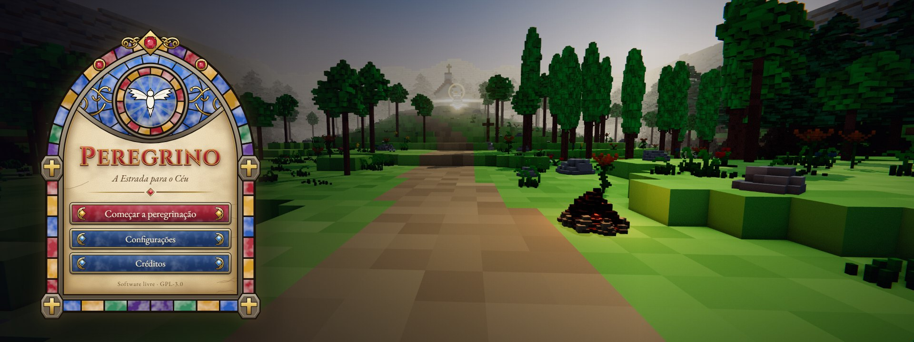
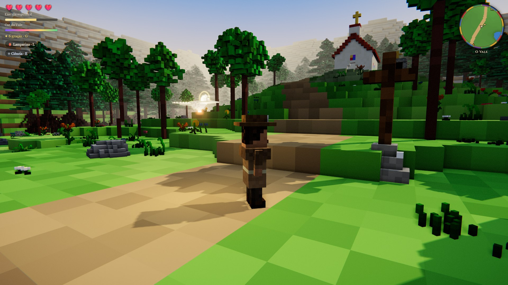
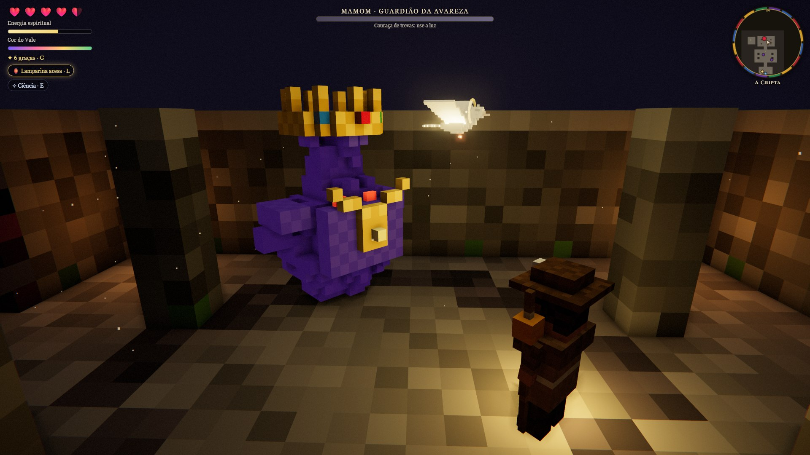
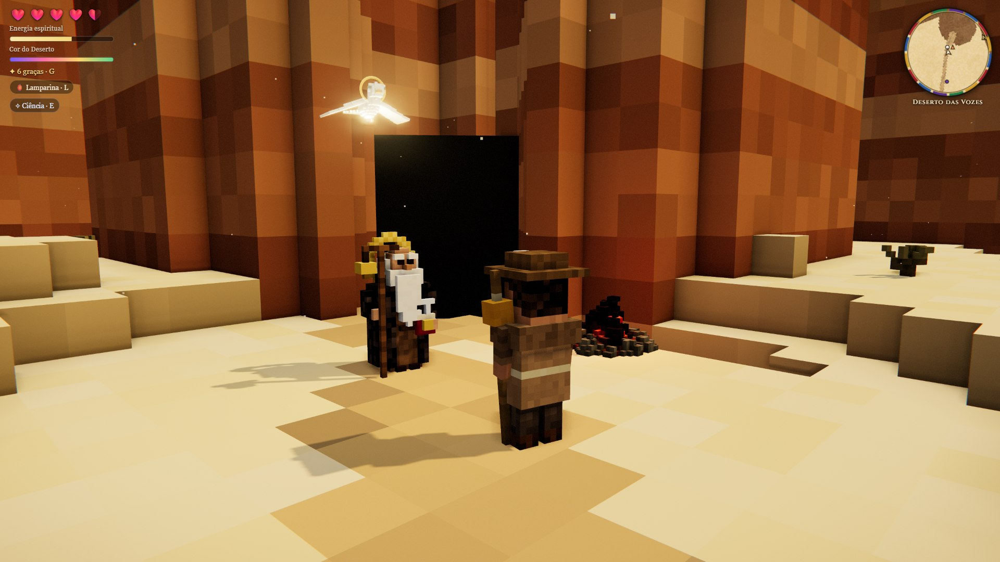
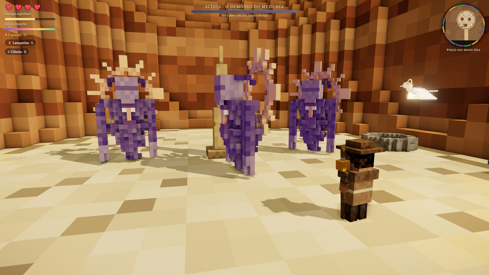
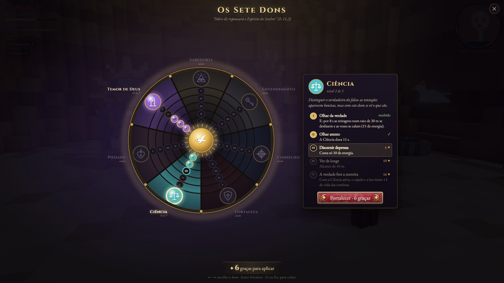
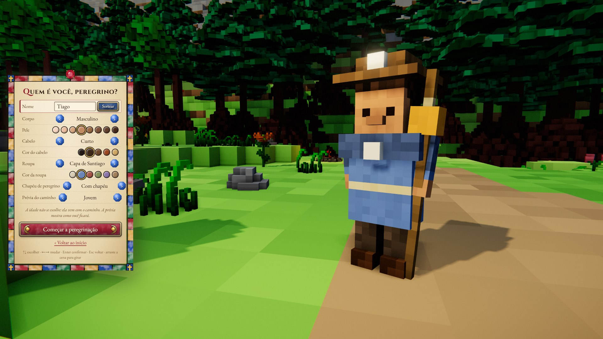

# 

[](https://github.com/Wisley56/Peregrino-A-Estrada-para-o-C-u/stargazers)
[](https://github.com/Wisley56/Peregrino-A-Estrada-para-o-C-u/issues)


## Bem-vindo ao Peregrino!

**Peregrino: A Estrada para o Céu** é uma aventura de ação em 3D, no estilo voxel, que roda direto no navegador.
Você é um peregrino que atravessa um mundo sem cor, vence as sombras com o cajado, a luz e a oração, e devolve as
cores a cada região. Pelo caminho, encontra santos que ensinam os Sete Dons do Espírito Santo e enfrenta os vícios
em forma de chefões.

O jogo é inspirado em Zelda, nos metroidvanias e na longa tradição das peregrinações cristãs. Toda a arte é feita
por código, o som é sintetizado na hora e o projeto inteiro é software livre.

## O que você encontra

<p>
  
  
  
  
  
  
</p>

- **O Vale**: estrada de terra, lago, pasto, pinheiros e a capela no alto do monte. Cada sombra vencida devolve um
  pouco de cor ao mundo.
- **A Cripta dos Primeiros Peregrinos**: braseiros para acender e **Mamom, o Guardião da Avareza**, que guarda a
  Lamparina da Fé.
- **O Deserto das Vozes**: miragens que tentam o peregrino, vozes ao vento e Santo Antão, que dá o dom da Ciência.
- **O Poço do Meio-Dia**: a **Acídia**, o demônio do meio-dia, escondida entre reflexos de si mesma.
- **Os Sete Dons**: uma rosácea de vitral onde as graças conquistadas fortalecem cada dom.
- **Seu peregrino**: nome, corpo, pele, cabelo, roupa e chapéu à sua escolha. Ele envelhece ao longo da história.

## Jogar

O jogo roda em qualquer navegador moderno com WebGL 2, no Windows, no macOS e no Linux. Para rodar a partir do
código:

1. Instale o [Node.js](https://nodejs.org) (18 ou mais novo) e o [Git](https://git-scm.com).
2. Baixe o projeto e instale as dependências:

   ```bash
   git clone https://github.com/Wisley56/Peregrino-A-Estrada-para-o-C-u.git
   cd Peregrino-A-Estrada-para-o-C-u
   npm install
   npm run dev
   ```

3. Abra <http://localhost:5180>.

O progresso fica salvo no próprio navegador, em 3 espaços de jogo. Em **Configurações → Gráficos** há predefinições
de Baixa a Ultra, para ajustar o visual ao seu computador.

### Controles

| Ação | Tecla |
|---|---|
| Andar / correr | WASD / Shift |
| Girar a câmera | Mouse (clique para prender o ponteiro) |
| Pular / esquivar | Espaço / C |
| Travar a mira | Q, Tab ou botão do meio |
| Golpe de cajado | Clique esquerdo ou J |
| Luz | Botão direito ou K |
| Rezar (parado) | Segurar R |
| Interagir | F ou Enter |
| Lamparina da Fé | L |
| Dom da Ciência | E |
| Os Sete Dons | G |
| Pausa | Esc ou P |

## Desenvolvimento

Toda ajuda é bem-vinda, e não é preciso programar para ajudar. Quem joga e conta o que achou, quem desenha, quem
compõe ou quem revisa os textos já faz o caminho andar.

Achou um bug ou teve uma ideia? [Abra uma issue](https://github.com/Wisley56/Peregrino-A-Estrada-para-o-C-u/issues/new).
Se o projeto te tocou, deixe uma ⭐ no [repositório](https://github.com/Wisley56/Peregrino-A-Estrada-para-o-C-u): ajuda
mais gente a encontrar o caminho.

Para quem quer mexer no código, o [guia do desenvolvedor](DEVELOPER.md) explica:

- como rodar e gerar o build;
- a arquitetura e a estrutura de pastas;
- os saves e as preferências;
- as malhas voxel e o pipeline gráfico;
- as regras do jogo e como incluir assets novos.

## Links úteis

- [Repositório no GitHub](https://github.com/Wisley56/Peregrino-A-Estrada-para-o-C-u): o código-fonte.
- [Issues](https://github.com/Wisley56/Peregrino-A-Estrada-para-o-C-u/issues): bugs, sugestões e ideias.
- [Guia do desenvolvedor](DEVELOPER.md): a parte técnica do projeto.
- [Créditos](CREDITOS.md): a origem e a licença de cada asset.
- [Fontes de assets](docs/FONTES-DE-ASSETS.md): onde buscar assets livres e quais licenças são aceitas.
- [Licença](LICENSE): o texto completo da GNU GPL 3.0.

## FAQ

### **P:** Qual é a licença do jogo?

**R:** O Peregrino é livre para jogar, estudar, modificar e distribuir, sob a
[GNU General Public License 3.0 ou posterior](LICENSE).

### **P:** Em quais plataformas ele roda?

**R:** Em qualquer navegador moderno com WebGL 2, no Windows, no macOS e no Linux. O jogo foi feito para teclado e
mouse.

### **P:** Meu computador é fraco. Consigo jogar?

**R:** Sim. Em **Configurações → Gráficos**, a predefinição **Baixa** desliga os efeitos pesados. A tela mostra os
quadros por segundo, para você ver o custo de cada ajuste.

## Créditos

Os modelos voxel dos bichos, árvores, flores, grama, pedras e fogueira vêm do [Veloren](https://veloren.net) (GPL-3.0),
o RPG voxel livre feito pela comunidade. As fontes são Cinzel e EB Garamond (SIL Open Font License). O detalhe de cada
obra está em [CREDITOS.md](CREDITOS.md).

Obrigado:

- à comunidade do software livre, que torna projetos como este possíveis;
- aos contribuidores do Veloren, pelos modelos e pela inspiração;
- a quem joga, testa e dá sugestões;
- aos peregrinos de todos os caminhos.

> "Eu sou o Caminho, a Verdade e a Vida." (João 14,6)
